<!-- README.md is generated from README.Rmd. Please edit that file -->

# pliman 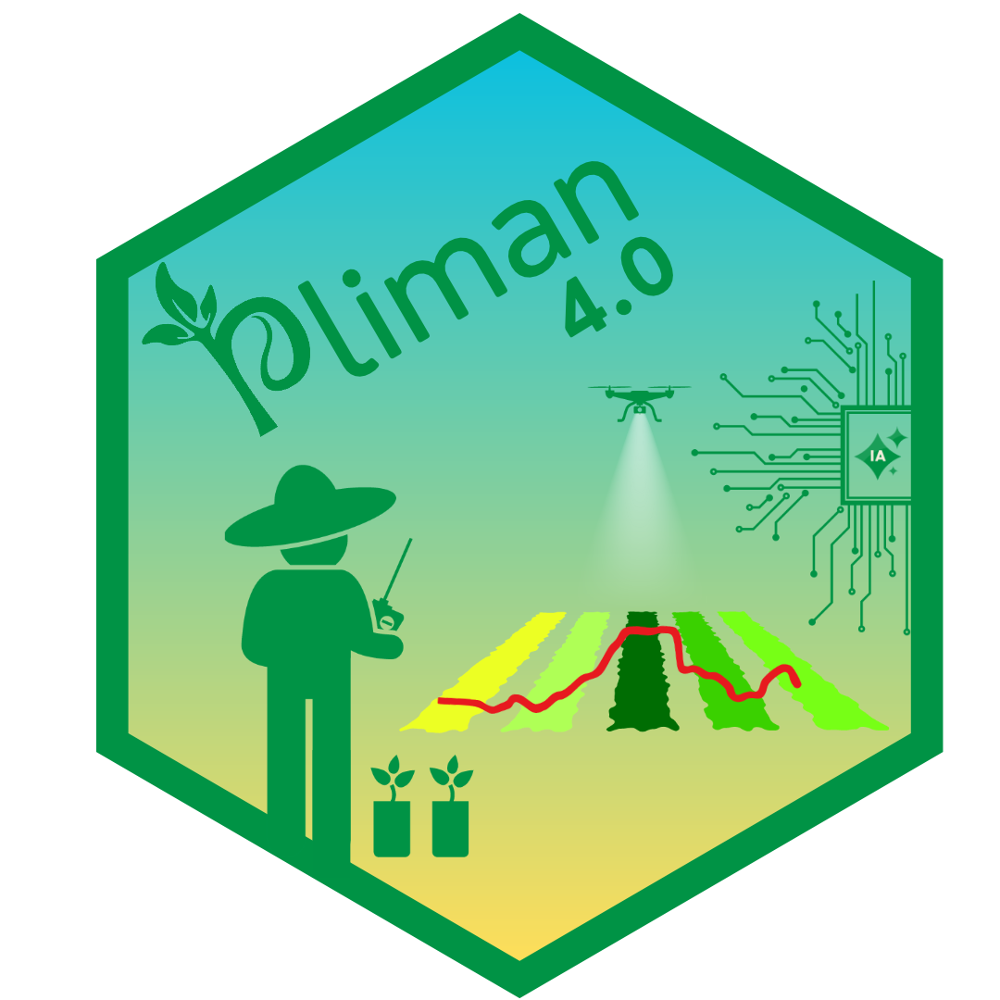

<!-- badges: start -->

[](https://CRAN.R-project.org/package=pliman)
[](https://lifecycle.r-lib.org/articles/stages.html#stable)

[](https://r-pkg.org/pkg/pliman)
[](https://r-pkg.org/pkg/pliman)
[](https://r-pkg.org/pkg/pliman)
[](https://doi.org/10.32614/CRAN.package.pliman)

<!-- badges: end -->

The pliman package offers tools for both single and batch image
manipulation and analysis ([Olivoto,
2022](https://onlinelibrary.wiley.com/doi/abs/10.1111/2041-210X.13803)),
including the quantification of leaf area, disease severity assessment
([Olivoto et al.,
2022](https://link.springer.com/article/10.1007/s40858-021-00487-5)),
object counting, extraction of image indexes, shape measurement, object
landmark identification, and Elliptical Fourier Analysis of object
outlines, as detailed by Claude
([2008](https://link.springer.com/book/10.1007/978-0-387-77789-4)). The
package also provides a comprehensive pipeline for generating shapefiles
with complex layouts and supports high-throughput phenotyping of RGB,
multispectral, and hyperspectral orthomosaics. This functionality
facilitates field phenotyping using UAV- or satellite-based imagery.

In addition, `pliman` runs pre-trained deep learning models directly
from R, through Microsoft ONNX Runtime and without Python. These include
object detection, instance segmentation, pose estimation and image
classification with YOLO26; segmentation from text, point or box prompts
with SAM 2.1 (Grounded-SAM and PerSAM); counting of touching grains and
seeds with StarDist; background removal; depth estimation; feature
extraction with DINOv2; and super-resolution. Models run on the CPU or,
when available, on the GPU, and can also be applied to batches of images
and to videos.

`pliman` also provides useful functions for image transformation,
binarization, segmentation, and resolution. Please visit the
[Examples](https://nepem-ufsc.github.io/pliman/reference/index.html)
page on the `pliman` website for detailed documentation of each
function.

# Installation

Install the latest stable version of `pliman` from
[CRAN](https://CRAN.R-project.org/package=pliman) with:

``` r
install.packages("pliman")
```

The development version of `pliman` can be installed from
[GitHub](https://github.com/nepem-ufsc/pliman) using the
[pak](https://github.com/r-lib/pak) package:

``` r
if(!requireNamespace("pak", quietly = TRUE)){
  install.packages("pak")
}
pak::pkg_install("nepem-ufsc/pliman")
```

*Note*: If you are a Windows user, you should also first download and
install the latest version of
[Rtools](https://cran.r-project.org/bin/windows/Rtools/).

The deep learning functions described below are available from `pliman`
4.0.0 onward. Use `packageVersion("pliman")` to check your installed
version.

# Deep Learning & Foundation Models

`pliman` integrates pre-trained Computer Vision and Deep Learning
Foundation models running directly in C++ via Microsoft **ONNX
Runtime**, with zero Python or PyTorch dependency. Models automatically
execute with CPU multi-threading or hardware-accelerated Windows
DirectML GPU support (`engine = "gpu"`); see *Inference speed* below.

## Initial setup (ONNX Runtime)

Before the first use, `pliman` needs the ONNX Runtime library from
Microsoft and the model files. Both are saved in your user folder and
are reused in later sessions, so this setup is done only once per
computer. Python and PyTorch are not needed.

The easiest way is `onnx_setup()`. It looks for a compatible GPU,
installs ONNX Runtime, downloads three basic models (`u2netp`, `yolo26s`
and `dinov2`) and runs a short test of each one:

``` r
library(pliman)

# Uses the GPU when one is found; otherwise, the CPU
onnx_setup()

# CPU only
onnx_setup(engine = "cpu")

# Configure ONNX Runtime only, without downloading models
onnx_setup(models = NULL)
```

You can also do each step yourself:

``` r
# 1. List the GPUs that can be used (DirectX 12 / DirectML, Windows)
pliman_gpu_info()

# 2. Install ONNX Runtime
onnx_install(engine = "gpu")   # DirectML (Windows); on Linux and macOS, it installs the CPU version
onnx_install(engine = "cpu")   # CPU (Windows, Linux and macOS)
onnx_install(engine = "cuda")  # NVIDIA CUDA/TensorRT (Windows and Linux)
pliman_gpu_provider("cuda")    # use CUDA instead of DirectML

# 3. Download the models used in the examples below
pliman_download_model(c("yolo26n", "yolo26n-seg", "grounded-sam", "sam2.1"))

# 4. Check the installed models and where they are saved
pliman_available_models()
pliman_model_dir()
```

Notes:

- With `engine = "gpu"`, models run on the GPU through DirectML, which
  is available only on Windows (DirectX 12). On Linux, use the CUDA
  version of ONNX Runtime on NVIDIA GPUs; on macOS, models run on the
  CPU.
- Downloads can take a while: the larger models, such as `grounded-sam`
  (about 315 MB) and `rmbg-2.0` (about 980 MB), are hundreds of
  megabytes.
- If a model is not installed, it is downloaded the first time a
  function uses it.
- To delete models and free disk space, use `pliman_remove_model()`.

## Available models

| Task / Capability | Function | Supported Models | Description |
|:---|:---|:---|:---|
| **Object Detection** | `image_detect_dl()` | `yolo26[n/s/m/l/x]` | Real-time object detection with bounding boxes (80 COCO classes). |
| **Instance Segmentation** | `image_segment_dl()` | `yolo26[n/s/m/l/x]-seg` | Real-time instance segmentation with continuous bilinear sub-pixel mask interpolation and 28 morphological features. |
| **Pose Estimation** | `image_pose_dl()` | `yolo26[n/s/m/l/x]-pose` | Real-time human pose estimation with 17 COCO keypoints and skeleton visualization. |
| **Image Classification** | `image_classify_dl()` | `yolo26[n/s/m/l]-cls` | Fast ImageNet 1,000-class image classification. |
| **Star-Convex Segmentation** | `image_stardist_dl()` | `stardist`, `stardist-dsb2018` | 48-ray star-convex polygon detection for round, convex, or touching grains, seeds, and cells. |
| **3D Depth Estimation** | `image_depth_dl()` | `depth-anything-v2` | Monocular 3D relative depth estimation (Depth Anything V2 Small, 518×518). |
| **Semantic Foundation Features** | `image_features_dl()` | `dinov2` | Dense 384-D patch embeddings and top-3 PCA false-color semantic segmentation via DINOv2 (ViT-S/14). |
| **Super-Resolution** | `image_superres_dl()` | `realesrgan_x2_full`, `realesrgan_x4_full`, `realesrgan` | Photorealistic 2x/4x generative super-resolution (RRDBNet full models or ultra-fast compact). |
| **Text-Prompted Segmentation** | `image_segment_dl()` | `grounded-sam` | Zero-shot open-vocabulary instance segmentation via Grounding DINO + SAM 2.1. |
| **One-Shot Exemplar Counting** | `image_segment_dl()` | `persam` | One-shot visual exemplar segmentation and counting via SAM 2.1 and Dense Conv ZNCC. |
| **Promptable Segmentation** | `image_segment_dl()` | `sam2.1` | Zero-shot segmentation of any object from a point or bounding-box prompt (SAM 2.1 Hiera-Tiny). |
| **Salient Background Removal** | `image_remove_bg()` | `ben2`, `u2netp`, `rmbg-2.0` | Ultra-sharp boundary cutouts and transparent background export. |
| **Video Detection and Tracking** | `video_detect_dl()` | `yolo26[n/s/m/l/x]`, `yolo26[n/s/m/l/x]-seg` | Detection, tracking and line counting on video files or a webcam. |

## A worked example: a farm scene

The examples below use `farm.jpg`, an image installed with `pliman`, to
show detection and segmentation with YOLO26 and with SAM 2.1. Each model
is downloaded the first time it is used.

``` r
library(pliman)
farm <- image_pliman("farm.jpg", plot = TRUE)
```


### Object detection with YOLO26

`image_detect_dl()` returns one bounding box per object for the 80 COCO
classes (people, animals, vehicles, …).

``` r
boxes <- image_detect_dl(farm, model = "yolo26n")
```

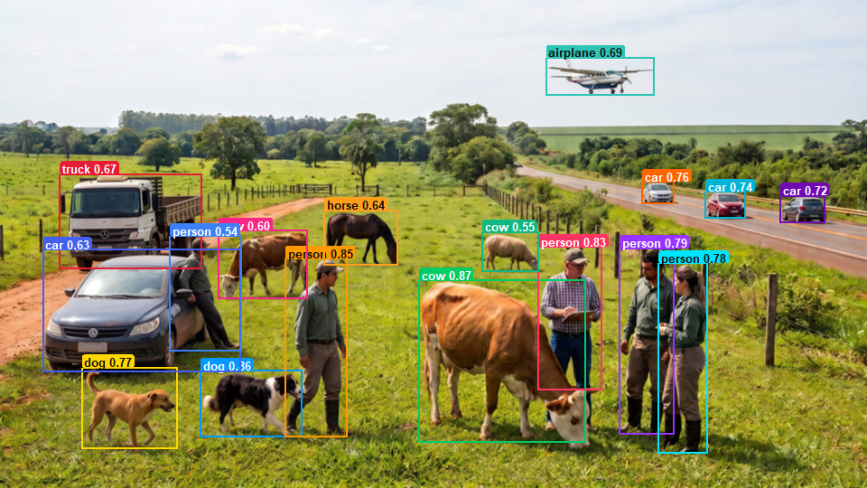

``` r
head(boxes)
#   id     xmin     ymin     xmax     ymax  label  score class_id    cx    cy
# 1  1 464.8404 311.4652 648.5944 490.3186    cow 0.8668       19 556.7 400.9
# 2  2 222.8035 411.4532 335.3050 483.6577    dog 0.8588       16 279.1 447.6
# 3  3 316.7741 287.4509 385.0814 483.8557 person 0.8505        0 350.9 385.7
# 4  4 597.4182 274.3113 667.0633 432.4959 person 0.8336        0 632.2 353.4
# 5  5 686.9260 275.6002 747.2949 481.3179 person 0.7870        0 717.1 378.5
# 6  6 730.2923 292.4690 784.1220 501.8815 person 0.7820        0 757.2 397.2
#      area
# 1 32865.0
# 2  8123.1
# 3 13415.9
# 4 11016.8
# 5 12418.9
# 6 11272.6
```

### Instance segmentation with YOLO26

With a `-seg` model, `image_segment_dl()` also returns a pixel mask for
each object, the number of objects per class and 28 shape measures for
each mask (area, perimeter, circularity, …).

``` r
seg <- image_segment_dl(
  farm,
  model = "yolo26n-seg",
  type = "highlight",
  bbox = TRUE
)
```

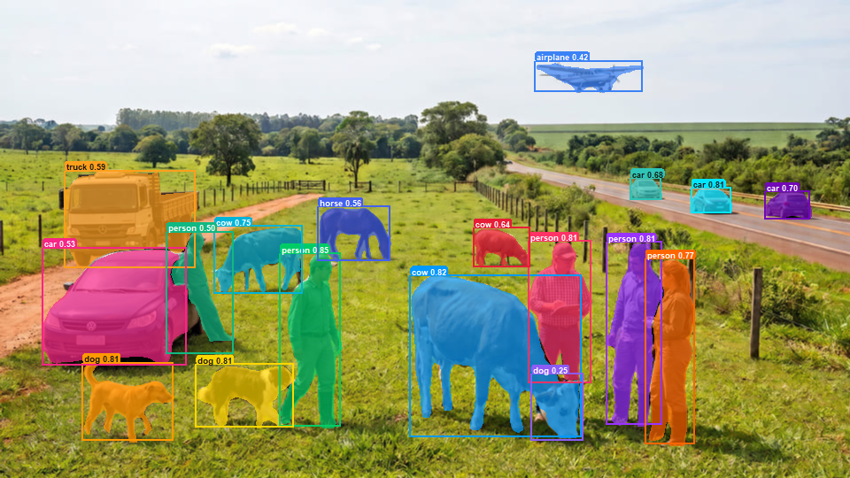

``` r
seg$counts
#      class count
# 1   person     5
# 2      cow     3
# 3      dog     3
# 4      car     4
# 5    truck     1
# 6    horse     1
# 7 airplane     1
head(seg$results[, c("label", "score", "area", "perimeter", "circularity")])
#    label  score    area perimeter circularity
# 1 person 0.8504  7850.0  603.9899    46.47182
# 2    cow 0.8165 19741.5 1092.1392    60.41932
# 3    dog 0.8147  3822.0  505.9899    66.98738
# 4 person 0.8144  6645.5  437.4630    28.79751
# 5 person 0.8141  7862.0  625.2203    49.72023
# 6    car 0.8128  1029.5  131.0122    16.67236
```

### Text-prompted segmentation with SAM 2.1 (Grounded-SAM)

`model = "grounded-sam"` finds objects described by a text `prompt` with
Grounding DINO and segments them with SAM 2.1. The classes are not
limited to a fixed list, so you can ask for objects that YOLO was not
trained on. Here, `box_threshold` is raised so that only the animals are
kept; with the default (`0.25`), the airplane is also labeled as an
animal.

``` r
animals <- image_segment_dl(
  farm,
  model = "grounded-sam",
  prompt = "animal",
  box_threshold = 0.58,
  type = "highlight",
  bbox = TRUE
)
```

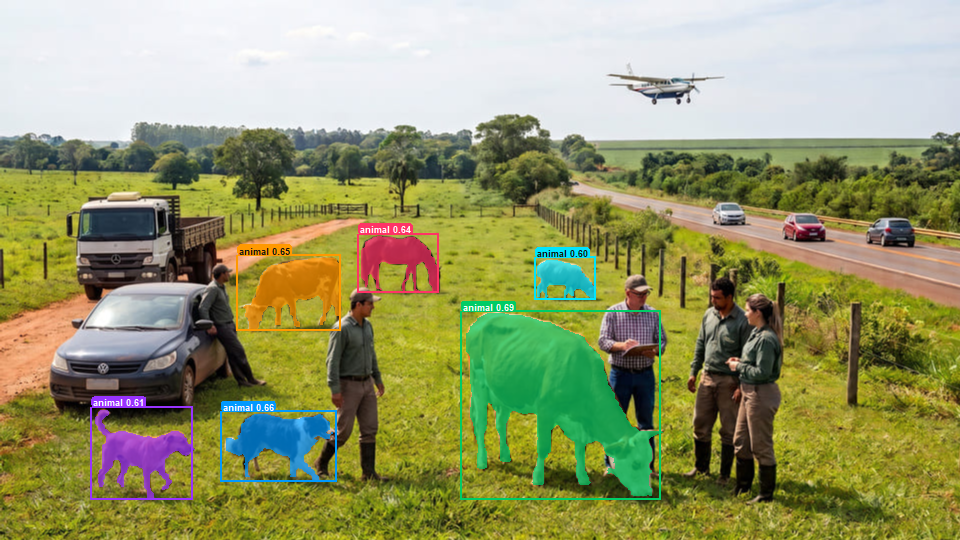

``` r
animals$counts
#    label count
# 1 animal     6
```

### One-shot segmentation from an example (PerSAM)

With `model = "persam"`, you give the position of one example object
(`prompt`, as x and y pixel coordinates), and SAM 2.1 finds and segments
all similar objects in the image. Below, a single point on the cow in
the front finds all the animals. Use a higher `sim_threshold` to keep
only objects that are more similar to the example. In an interactive
session, leave `prompt` out to click on the examples instead.

``` r
plot(farm)
points(540, 380, pch = 16, col = "red", cex = 2)
```

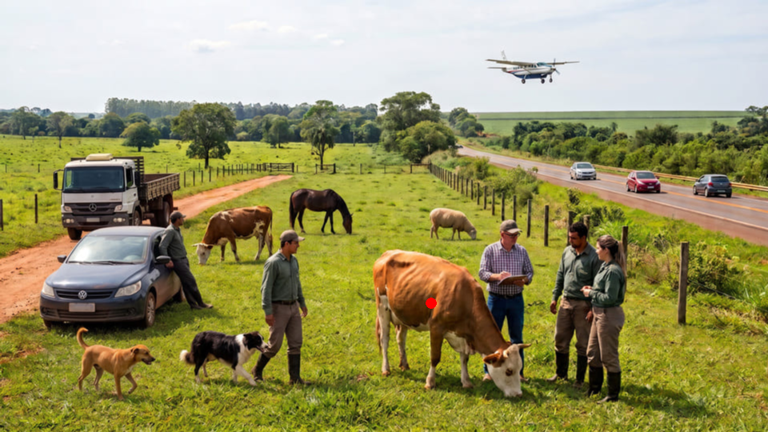

``` r

similar <- image_segment_dl(
  farm,
  model = "persam",
  prompt = rbind(c(540, 380)),
  sim_threshold = 0.6,
  type = "highlight",
  bbox = TRUE
)
```

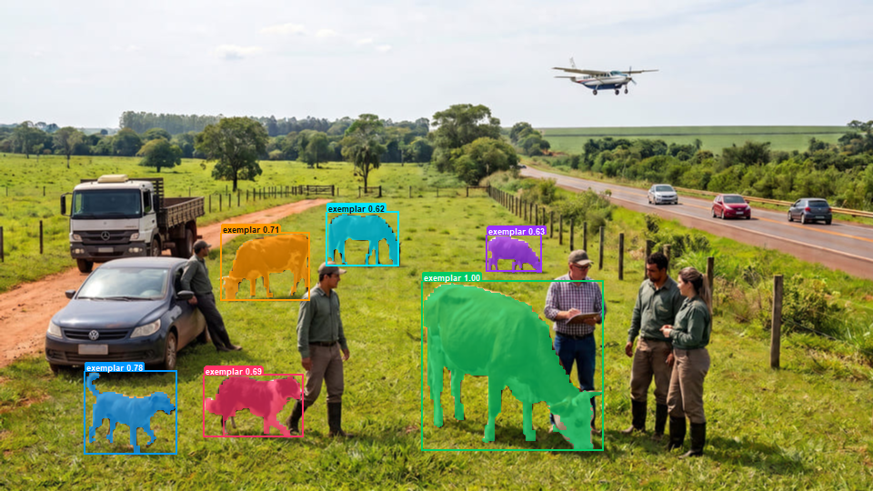

``` r

nrow(similar$results)
# [1] 6
```

### Point and box prompts with SAM 2.1

`model = "sam2.1"` segments the object inside a box given as
`c(xmin, ymin, xmax, ymax)`, or the object under a point given as
`c(x, y)`. Here, a box around the man in the center of the image:

``` r
plot(farm)
rect(312, 285, 390, 485, lwd = 3, border = "red")
```

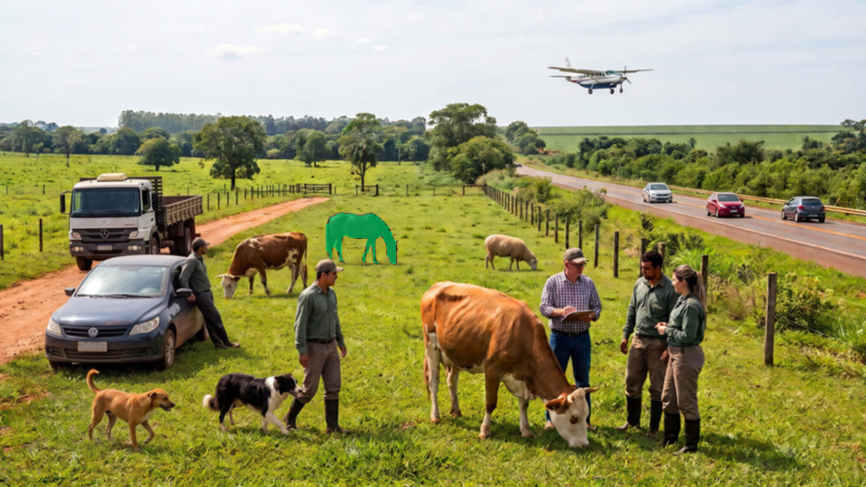

``` r

man <- image_segment_dl(
  farm,
  model = "sam2.1",
  prompt = c(312, 285, 390, 485),
  type = "highlight"
)
```

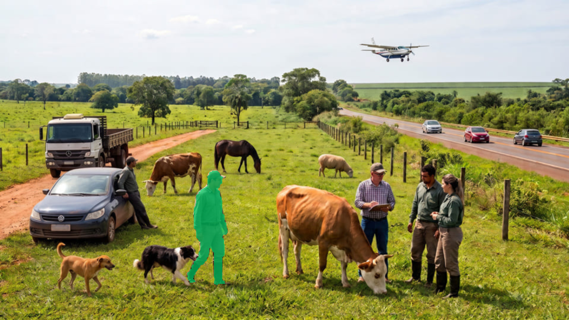

## More examples

### 1. Monocular 3D Depth Estimation (Depth Anything V2)

``` r
# Computes relative 3D depth and displays with an inferno colormap
depth_img <- image_depth_dl(farm, col_palette = "inferno")
```

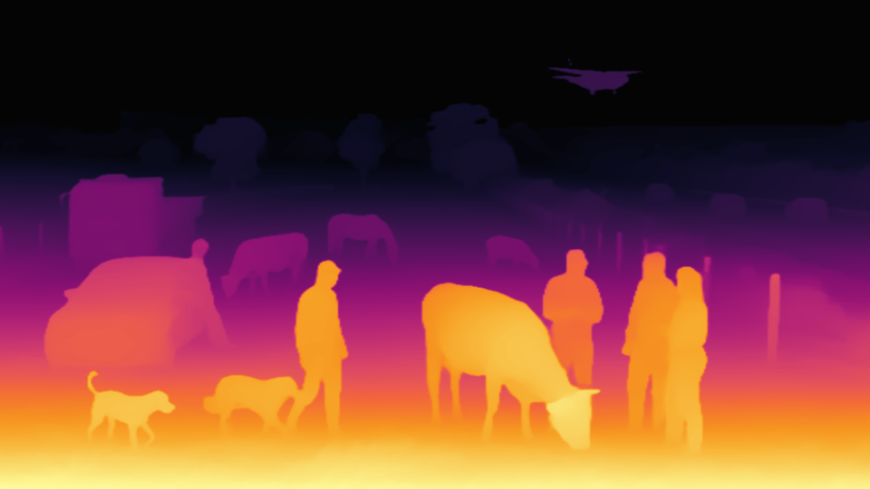

``` r

# Access raw continuous depth values
raw_depth <- attr(depth_img, "depth")
str(raw_depth)
#  num [1:960, 1:540] 0 0 0 0 0 0 0 0 0 0 ...
```

### 2. Foundation Semantic Embeddings (DINOv2)

``` r
# Extract 384-dimensional ViT patch embeddings and top-3 PCA false-color map
feats <- image_features_dl(farm, return_pca = TRUE)
```

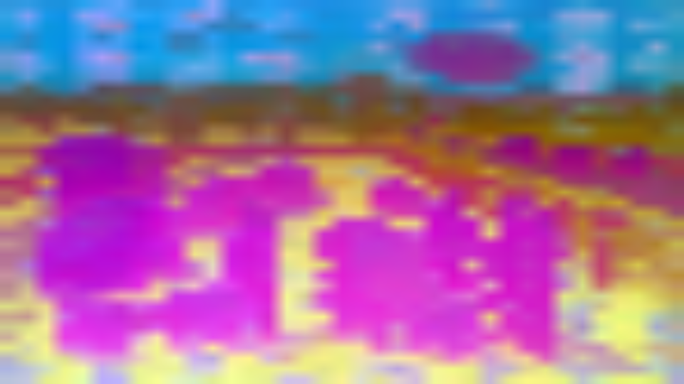

``` r

# Global image classification token vector (384 values)
str(feats$cls_token)
#  num [1:384] 2.12 4.92 3.18 -1.84 2 ...
```

### 3. Generative Super-Resolution (Real-ESRGAN)

``` r
img <- image_pliman("soy_green.jpg")

# 2x Photorealistic super-resolution (RRDBNet default)
img_2x <- image_superres_dl(img, plot = FALSE)

image_combine(img, img_2x, nrow = 2)
```


### 4. Inference speed

Models run through ONNX Runtime in C++. Sessions are cached for the
whole R session, so only the first call loads the model (and, on GPU,
compiles it). Pre-processing, non-maximum suppression, mask decoding,
SAHI tiling and video tracking also run in C++.

- `engine = "gpu"` uses DirectML on Windows (DirectX 12). Gains depend
  on the GPU; small models on integrated GPUs can be slower than a
  multi-core CPU.
- `engine = "cpu"` uses `threads` ONNX Runtime threads (`0` = all
  physical cores).
- FP16 models (`yolo_export_fp16()`) are faster only on GPUs with native
  half-precision throughput, such as NVIDIA Tensor Cores (RTX 20xx and
  newer). On GPUs without fast FP16 (e.g. GTX 10xx/16xx) or on CPU the
  casting overhead can make them slower. Dynamic INT8 models
  (`onnx_quantize()`) target the CPU.
- For many images use `image_detect_dl_batch()` (and `pliman_daemons()`
  to keep parallel workers and their models alive). Use `plot = FALSE`
  inside loops.
- For video, `infer_every`, `fps`, `imgsz` and `show = FALSE` are the
  main speed levers.

``` r
# Measure inference speed on this machine, using the farm image
yolo_benchmark("yolo26n", img = farm, engine = "gpu")
#              stage ms_mean ms_sd ms_min   fps n_objects
#    inference (C++)   17.88  2.61  15.78 55.93        17
#  image_detect_dl()   21.94  3.50  18.43 45.58        17
yolo_benchmark("yolo26n", img = farm, engine = "cpu", sahi = TRUE)
#                stage ms_mean ms_sd ms_min   fps n_objects
#      inference (C++)   67.20 20.21  48.11 14.88        17
#    image_detect_dl()   56.99  3.71  48.92 17.55        17
#  image_detect_sahi()  222.27 84.15 171.12  4.50        17

# Inspect cached ONNX sessions
pliman_session_info()
#                          model   gpu requested_gpu device_id threads n_inputs
# 1                 yolo26n.onnx FALSE         FALSE        -1       0        1
# 2                 yolo26n.onnx  TRUE          TRUE         1       0        1
# 3      realesrgan_x2_full.onnx  TRUE          TRUE         1       0        1
# 4           dinov2-vits14.onnx  TRUE          TRUE         1       0        1
# 5 depth-anything-v2-small.onnx  TRUE          TRUE         1       0        1
# 6          sam2.1.decoder.onnx FALSE         FALSE        -1       0        7
# 7          sam2.1.encoder.onnx FALSE         FALSE        -1       0        1
#   n_outputs    input_dims batch_dynamic spatial_dynamic warmed_up
# 1         1       ?x3x?x?          TRUE            TRUE     FALSE
# 2         1       ?x3x?x?          TRUE            TRUE     FALSE
# 3         1       1x3x?x?         FALSE            TRUE     FALSE
# 4         1       ?x?x?x?          TRUE            TRUE     FALSE
# 5         1       ?x3x?x?          TRUE            TRUE     FALSE
# 6         2   1x256x64x64         FALSE           FALSE     FALSE
# 7         3 1x3x1024x1024         FALSE           FALSE     FALSE
#   fell_back_to_cpu provider graph_cache create_ms fallback_reason
# 1            FALSE      cpu         off  158.0803                
# 2            FALSE      dml         off  214.5330                
# 3            FALSE      dml         off  764.7453                
# 4            FALSE      dml         off  356.7052                
# 5            FALSE      dml         off  535.3404                
# 6            FALSE      cpu         off  219.7311                
# 7            FALSE      cpu         off 3226.2314                
#   vram_pressured lru_rank
# 1          FALSE        1
# 2          FALSE        2
# 3          FALSE        3
# 4          FALSE        4
# 5          FALSE        5
# 6          FALSE        6
# 7          FALSE        7
#                                                                                             key
# 1                   C:/Users/tiago/AppData/Roaming/R/data/R/pliman/models/yolo26n.onnx_th_0_cpu
# 2                 C:/Users/tiago/AppData/Roaming/R/data/R/pliman/models/yolo26n.onnx_th_0_gpu_1
# 3      C:/Users/tiago/AppData/Roaming/R/data/R/pliman/models/realesrgan_x2_full.onnx_th_0_gpu_1
# 4           C:/Users/tiago/AppData/Roaming/R/data/R/pliman/models/dinov2-vits14.onnx_th_0_gpu_1
# 5 C:/Users/tiago/AppData/Roaming/R/data/R/pliman/models/depth-anything-v2-small.onnx_th_0_gpu_1
# 6            C:/Users/tiago/AppData/Roaming/R/data/R/pliman/models/sam2.1.decoder.onnx_th_0_cpu
# 7            C:/Users/tiago/AppData/Roaming/R/data/R/pliman/models/sam2.1.encoder.onnx_th_0_cpu
```

### 5. Video Detection

``` r
# Live detection from the default webcam (video = 0); press <Esc> to stop
res <- video_detect_dl(
  model = "yolo26n"
)

# Video detection with tracking and line counting
tracked <- video_detect_dl(
  video                  = "video.mp4",         # input video (or a camera index, e.g. 0)
  output                 = "video_tracked.mp4", # annotated video saved to this file
  model                  = "yolo26n-seg",       # YOLO26 segmentation model (boxes + masks)
  engine                 = "gpu",               # run on the GPU (DirectML); use "cpu" otherwise
  track                  = TRUE,                # keep the same ID for each object across frames
  roi                    = c(0.5, 1),           # region of interest: from 50% to 100% of the width
  roi_orientation        = "vertical",          # the ROI is a vertical band (right half of the frame)
  count_line             = 0.5,                 # counting line at 50% of the width
  count_line_orientation = "vertical"           # the line is vertical; objects crossing it are counted
)
```

# Analyze objects

The function `analyze_objects()` can be used to analyze objects such as
leaves, grains, pods, and pollen in an image. By default, all measures
are returned in pixel units. Users can [adjust the object
measures](https://nepem-ufsc.github.io/pliman/articles/analyze_objects.html#adjusting-object-measures)
with `get_measures()` provided that the image resolution (Dots Per Inch)
is known. Another option is to use a reference object in the image. In
this last case, the argument `reference` must be set to `TRUE`. There
are two options to identify the reference object:

1.  By its color, using the arguments `back_fore_index` and
    `fore_ref_index`\
2.  By its size, using the arguments `reference_larger` or
    `reference_smaller`

In both cases, the `reference_area` must be declared. Let’s see how to
analyze an image with flax grains containing a reference object
(rectangle with 2x3 cm). Here, we’ll identify the reference object by
its size; so, the final results in this case will be in metric units
(cm).

``` r
library(pliman)
img <- image_pliman("flax_grains.jpg")
flax <- 
  analyze_objects(img,
                  index = "GRAY",
                  reference = TRUE,
                  reference_larger = TRUE,
                  reference_area = 6,
                  marker = "point",
                  marker_size = 0.5,
                  marker_col = "red", # default is white
                  show_contour = FALSE) # default is TRUE
```

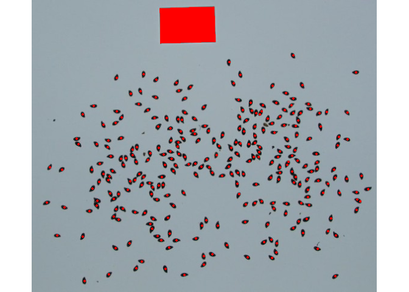

``` r
# summary statistics
flax$statistics
#        stat        value
# 1         n 272.00000000
# 2  min_area   0.00000000
# 3 mean_area   0.00000000
# 4  max_area   0.10000000
# 5   sd_area   0.00000000
# 6  sum_area  13.10000000
# 7  coverage   0.04107791
```

# Disease severity

## Using image indexes

To compute the percentage of symptomatic leaf area, you can use the
`measure_disease()` function. You can use an image index to segment the
entire leaf from the background and then separate the diseased tissue
from the healthy tissue. Alternatively, you can provide color palette
samples to the `measure_disease()` function. In this approach, the
function fits a general linear model (binomial family) to the RGB values
of the image. It then uses the color palette samples to segment the
lesions from the healthy leaf.

In the following example, we compute the symptomatic area of a soybean
leaf. The proportion of healthy and symptomatic areas is given as a
proportion of the total leaf area after segmenting the leaf from the
background (blue).

``` r
img <- image_pliman("sev_leaf.jpg")
# Computes the symptomatic area
sev <- 
  measure_disease(img = img,
                  index_lb = "B", # to remove the background
                  index_dh = "NGRDI", # to isolate the diseased area
                  threshold = c("Otsu", 0), # You can also use the Otsu algorithm in both indexes (default)
                  plot = TRUE)
# ℹ Processing a single image. Please, wait.
```

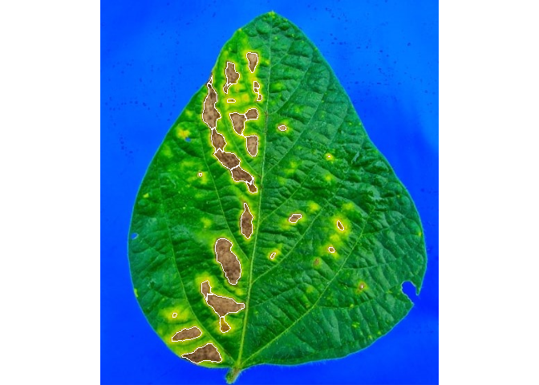

    # ✔ Image Successfully analyzed! [340ms]
    # 
    sev$severity
    #    healthy symptomatic
    # 1 95.91434    4.085663

## Interactive disease measurements

An alternative approach to measuring disease percentage is available
through the `measure_disease_iter()` function. This function offers an
interactive interface that empowers users to manually select sample
colors directly from the image. By doing so, it provides a highly
customizable analysis method.

One advantage of using `measure_disease_iter()` is the ability to
utilize the “mapview” viewer, which enhances the analysis process by
offering zoom-in options. This feature allows users to closely examine
specific areas of the image, enabling detailed inspection and accurate
disease measurement.

``` r
img <- image_pliman("sev_leaf.jpg", plot = TRUE)

# works only in an interactive session
measure_disease_iter(img, viewer = "mapview")
```

# Citation

``` r
citation("pliman")
Please, support this project by citing it in your publications!

  Olivoto T (2022). "Lights, camera, pliman! An R package for plant
  image analysis." _Methods in Ecology and Evolution_, *13*(4),
  789-798. doi:10.1111/2041-210X.13803
  <https://doi.org/10.1111/2041-210X.13803>.

Uma entrada BibTeX para usuários(as) de LaTeX é

  @Article{,
    title = {Lights, camera, pliman! An R package for plant image analysis},
    author = {Tiago Olivoto},
    year = {2022},
    journal = {Methods in Ecology and Evolution},
    volume = {13},
    number = {4},
    pages = {789-798},
    doi = {10.1111/2041-210X.13803},
  }
```

# Getting help

If you come across any clear bugs while using the package, please
consider filing a minimal reproducible example on
[GitHub](https://github.com/nepem-ufsc/pliman/issues). This will help
the developers address the issue promptly.

Suggestions and criticisms aimed at improving the quality and usability
of the package are highly encouraged. Your feedback is valuable in
making {pliman} even better!

# Code of Conduct

Please note that the pliman project is released with a [Contributor Code
of Conduct](https://nepem-ufsc.github.io/pliman/CODE_OF_CONDUCT.html).
By contributing to this project, you agree to abide by its terms.
